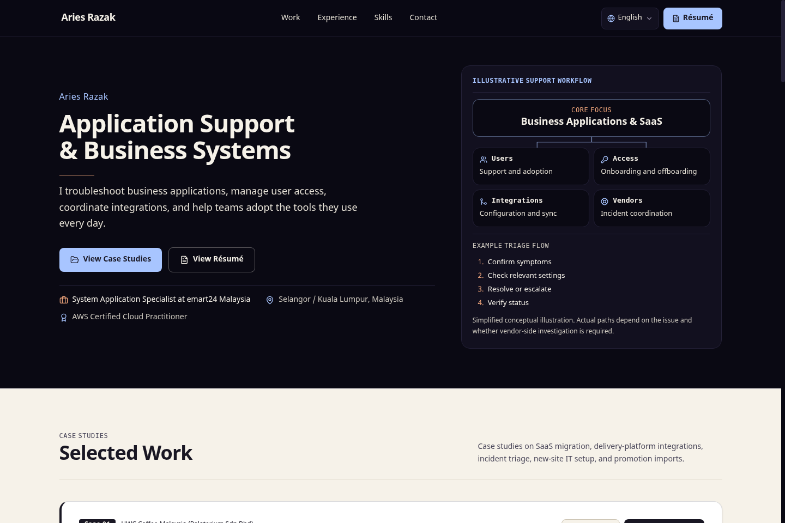

# Aries Razak | Personal Portfolio

Personal portfolio for **Muhammad Aries Irhan bin Abd Razak (Aries Razak)**, highlighting real experience across **Application Support, Business Systems, SaaS Administration, Integration Configuration, and IT Operations**.

- **Live Website:** [https://aries-razak.vercel.app/](https://aries-razak.vercel.app/)
- **Repository:** [https://github.com/Rizi3R/my-portfolio](https://github.com/Rizi3R/my-portfolio)
- **LinkedIn:** [linkedin.com/in/aries-razak-a36045256](https://www.linkedin.com/in/aries-razak-a36045256)
- **Contact:** [ariesirhan25@gmail.com](mailto:ariesirhan25@gmail.com)

---



## Key Features

- **Selected Work and case explorer:** The homepage starts with four featured cases. Open all 13 or search across the full collection by title, technology, or skill and filter by domain and case type. Technical timelines, deep links, and evidence labels distinguish confirmed results, vendor-led recovery, investigations, and assessments.
- **Career Timeline & Credentials:** Experience across emart24 Malaysia, HWC Coffee Malaysia (Palaterium Sdn Bhd), managed print services, and an application development internship at the Attorney General's Chambers of Malaysia, alongside a UiTM Diploma, AWS Certified Cloud Practitioner credential, AI Teach Malaysia completed program, and a clearly separated Currently Learning section (UiPath and RPA).
- **Static case pages:** The production build generates 13 crawlable English summaries, a case index, a no-script homepage fallback, and a sitemap from the canonical case data.
- **Multilingual Support (`en-MY`, `ms-MY`, `zh-Hans-MY`, `ta-MY`):** English ships in the entry bundle. Bahasa Melayu, Simplified Chinese, and Tamil load when selected. The header and `?lang=` support all four.
- **Printable Resume Viewer & Plain View:** Print-styled résumé modal (`Ctrl+P` / `Cmd+P`) and linear plain-text summary view.
- **Interactive Learning Tools:** Optional secondary views (`Beep to Receipt` walkthrough, interactive skills constellation, Computing Lab, command terminal, and `Ctrl+K` / `Cmd+K` command palette). Illustrative simulations use generic examples and are labeled separately from employer systems.
- **Content & i18n Validation:** Automated scripts (`validate:content`, `validate:i18n`) that check baseline factual consistency, case ordering, `UiPath` learning isolation, and key/placeholder parity across all four locales.
- **Optional Visitor Counter API (`/api/visitors`):** Privacy-preserving endpoint using HMAC-SHA256 digests and rate limiting when configured with Redis and `VISITOR_HASH_SALT`. (The current UI does not display a live counter badge; `/api/visitors` operates as an optional backend endpoint.)

---

## Tech Stack

Derived directly from `package.json` and deployment configuration:

- **Frontend:** React 19, TypeScript, Vite 8, Tailwind CSS 4, Lucide React
- **Local Server & API Parity:** Express 4, `tsx`, `dotenv`, Node.js built-in test runner (`node:test`)
- **Hosting & Optional Persistence:** Vercel static build + Node serverless function (`/api/visitors`), optional Upstash Redis / Vercel KV REST API

---

## Getting Started Locally

### Prerequisites

- **Node.js:** v22 recommended (matches CI in `.github/workflows/ci-security.yml`; use 22.12 or later on the 22.x line)
- **npm:** Use the bundled npm and the committed lockfile

### 1. Clone and install dependencies

```bash
git clone https://github.com/Rizi3R/my-portfolio.git
cd my-portfolio
npm ci
```

> **Note on `.npmrc`:** `.npmrc` sets `legacy-peer-deps=true` to keep npm dependency installation consistent across the toolchain versions in `package.json` (`typescript` 7.x and Vite 8 plugins).

### 2. Available scripts

| Command | Purpose |
| :--- | :--- |
| `npm run dev` | Start local Express + Vite dev server on `http://localhost:3000` |
| `npm run start` | Start `server.ts` (serves built `dist/` when `NODE_ENV=production`) |
| `npm run build` | Build production static assets into `dist/` (source maps disabled) |
| `npm run preview` | Preview the built `dist/` bundle via Vite |
| `npm run lint` | Run `tsc --noEmit` across frontend, node scripts/tests, and `api/` |
| `npm test` | Run unit tests for case filtering and `/api/visitors` |
| `npm run test:e2e` | Run desktop and mobile Chromium smoke tests and axe checks against the built portfolio |
| `npm run validate:content` | Check owner-provided content, dates, evidence refs, and copy rules |
| `npm run validate:i18n` | Validate all 4 locale bundles and URL locale resolution helpers |
| `npm run clean` | Remove `dist` and `server.js` build artifacts |

---

## Environment Variables (`/api/visitors`)

Copy `.env.example` to `.env.local` if you want to enable the optional `/api/visitors` endpoint locally:

| Variable | Required for `/api/visitors` | Purpose |
| :--- | :--- | :--- |
| `VISITOR_HASH_SALT` | Yes (`>= 16` chars) | Private HMAC-SHA256 key for one-way IP rate-limit and visit digests |
| `UPSTASH_REDIS_REST_URL` | On Vercel / remote Redis | Upstash Redis REST endpoint (`https://...`) |
| `UPSTASH_REDIS_REST_TOKEN` | On Vercel / remote Redis | Upstash Redis REST bearer token |
| `KV_REST_API_URL` | Alternative alias | Supported automatically instead of `UPSTASH_REDIS_REST_URL` |
| `KV_REST_API_TOKEN` | Alternative alias | Supported automatically instead of `UPSTASH_REDIS_REST_TOKEN` |

Generate a strong `VISITOR_HASH_SALT`:

```bash
openssl rand -hex 32
```

**Security and degradation rules:**
- Keep all credentials strictly server-side. Never prefix Redis tokens or `VISITOR_HASH_SALT` with `VITE_`.
- When `VISITOR_HASH_SALT` is unset or shorter than 16 characters (or when Redis credentials are absent in serverless mode), `/api/visitors` disables persistent tracking and responds with HTTP `200` `{ "configured": false, "count": null, "deduplicated": false }`. No raw IPs or User-Agent strings are stored, and no fallback public salt is used.
- Local development (`server.ts`) uses `.data/visitor-counter.json` only when `VISITOR_HASH_SALT` is set and Redis env vars are absent.

---

## Browser checks

```bash
npx playwright install chromium
npm run build
npm run test:e2e
```

Set `PLAYWRIGHT_CHROMIUM_EXECUTABLE` to use an installed Chromium binary. Set `PLAYWRIGHT_BASE_URL` to check a deployed instance of this version. Set `PLAYWRIGHT_EXPECTED_COMMIT` to require an exact commit match in the build manifest. The smoke suite covers featured and complete case lists, filters, deep links, keyboard and résumé focus, all four languages, and case-page rendering with scripting disabled.

## Vercel Deployment

`vercel.json` is configured for Vite + `/api/visitors`:
- **Install command:** `npm ci --include=dev`
- **Build command:** `npm run build`
- **Output directory:** `dist`
- **Security headers & SPA rewrites:** Applied in `vercel.json` for production responses and non-API client routes.

After deployment, compare the public `/build-info.json` commit with GitHub `main`. The field is set from `VERCEL_GIT_COMMIT_SHA` when Vercel exposes it and is `null` when the SHA is unavailable. The same file reports the built case count. Open `/cases/index.html` to check the static index independently of the interactive view.

To enable persistent visitor counting in production, configure `VISITOR_HASH_SALT` plus `UPSTASH_REDIS_REST_URL` / `UPSTASH_REDIS_REST_TOKEN` (or `KV_REST_API_*`) in **Vercel Project Settings -> Environment Variables** before deploying.

---

## Project Structure

```text
├── .env.example                 # Template for optional server-side visitor-counter env vars
├── .github/workflows/
│   └── ci-security.yml          # CI checks: lint, unit and browser tests, content/i18n, build, audit
├── .npmrc                       # Sets legacy-peer-deps=true for npm installs
├── api/
│   ├── _visitorCore.ts          # Shared salt validation, HMAC hashing, origin, and Redis helpers
│   ├── tsconfig.json            # TypeScript config for serverless handler
│   └── visitors.ts              # Optional Vercel serverless handler for /api/visitors
├── docs/
│   └── ARCHITECTURE.md          # Concise architecture and content-pipeline overview
├── public/
│   ├── robots.txt               # Crawler directives for production domain
│   └── sitemap.xml              # Development copy, replaced by the production generator
├── scripts/
│   ├── validate-content.ts      # Portfolio truthfulness and data integrity checks
│   ├── validate-i18n.ts         # 4-locale parity and translation completeness checks
│   └── generateStaticContent.ts # Static case HTML, homepage fallback, sitemap, build info
├── src/
│   ├── App.tsx                  # Root layout, view routing, modals, and keyboard shortcuts
│   ├── components/              # Page sections, views (Trace, Atlas, Plain, Receipt), Lab & modals
│   ├── data/universeContent.ts  # Canonical English profile, experience, case studies & nodes
│   ├── i18n/                    # Locale resolver, React context, and en/ms/zh-Hans/ta bundles
│   └── utils/                   # Audio toggle, clipboard helper, and modal focus trap hook
├── tests/
│   ├── *.test.ts                 # Visitor API and case-filtering unit tests
│   └── e2e/                     # Chromium smoke tests and axe scans
├── index.html                   # HTML shell, Open Graph tags, JSON-LD schema & no-JS fallback
├── package.json                 # Dependencies and npm scripts
├── server.ts                    # Local Express server with Vite dev middleware and /api/visitors
├── vercel.json                  # Vercel build, header, and SPA rewrite rules
└── vite.config.ts               # Vite configuration (sourcemap disabled for production)
```

---

## Development Notes & Limitations

- **AI-Assisted Development:** Aries used Google AI Studio during initial development and Codex for maintenance. Professional content is owner-provided. The validators check consistency and translation structure. Employment and language accuracy require human review.
- **Automated Check Scope:** `npm test` covers the case explorer and `/api/visitors` logic with a mocked `fetch`; live Redis connectivity, cross-browser UI rendering, and penetration testing are not covered automatically by CI.
- **Bundle Scan Scope:** The CI bundle check scans `dist/` for source maps and common credential/env-var patterns as basic build hygiene rather than a standalone security guarantee.
- **Repository License:** No open-source license file is currently included; code and personal portfolio content belong to Aries Razak unless a license is explicitly added.
